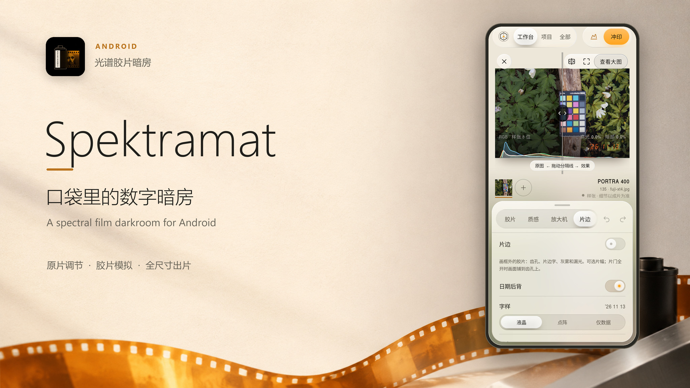
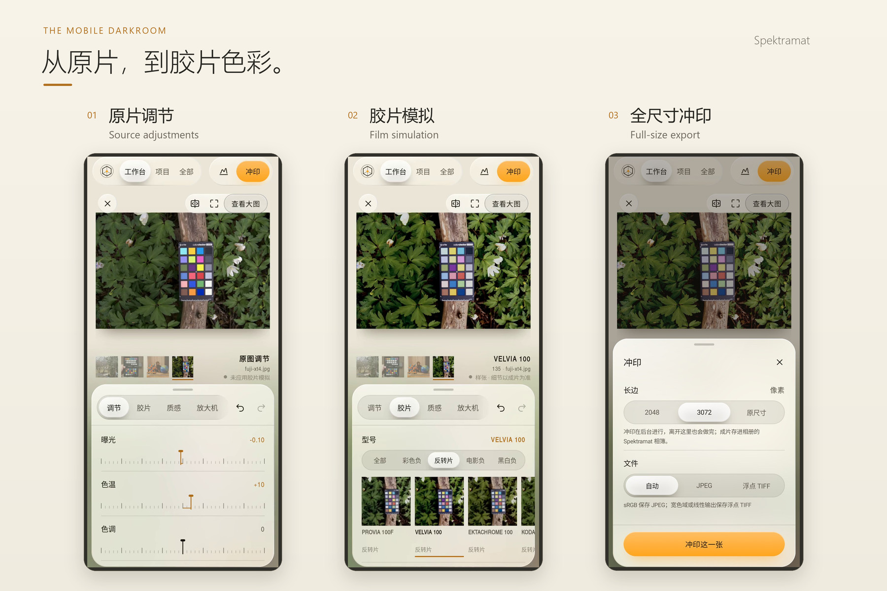
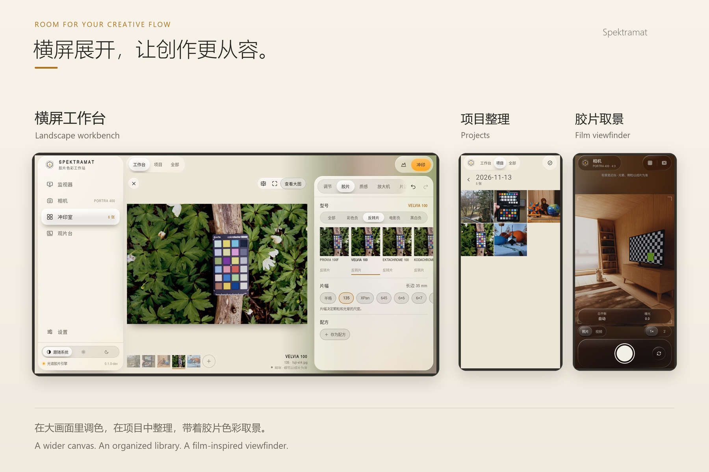
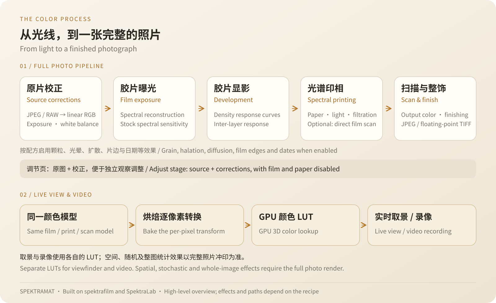

# Spektramat

**A spectral film darkroom for Android.**

[](LICENSE)

[](https://github.com/Knonoa/Spektramat/releases/tag/v0.1.0-preview.2)

[中文](README.md) · English · **[Download Android preview](https://github.com/Knonoa/Spektramat/releases/tag/v0.1.0-preview.2)** · [Watch the introduction](https://github.com/Knonoa/Spektramat/releases/download/v0.1.0-preview.1/spektramat-intro.mp4)

[](https://github.com/Knonoa/Spektramat/releases/download/v0.1.0-preview.1/spektramat-intro.mp4)

Start with an original. Adjust exposure and color, choose a film, then work with paper and filtration under the enlarger. Spektramat brings that process to your phone: **25 films, 9 papers, reusable recipes and a complete photo engine.** Photo processing runs locally on your device.

It builds on the spectral film model from [spektrafilm](https://github.com/andreavolpato/spektrafilm), with the native reference implementation and film/paper assets from [SpektraLab](https://github.com/JamesQiu2005/SpektraLab). This is a preview release; the interface is primarily in Chinese.

## Adjust the original, then choose your film



Five stages take the original toward your finished photograph:

| Adjustments | Film | Texture | Enlarger | Film Edge |
| --- | --- | --- | --- | --- |
| Exposure, white balance, curves, HSL, color grading and vignette | 25 films, film format and recipes | Grain, halation, inter-layer effects and paper glare where applicable | 9 papers or direct film scanning, print exposure and yellow/magenta filtration | Perforations, edge lettering, frame numbers, fog, light leaks, film gate and date back |

- **See the correction first.** The Adjustments tab shows changes on the original; move to the following stages to assess the film and print result.
- **Keep a look you love.** Save recipes, select multiple photos and apply or print in batches. Undo/redo, automatic saving, a histogram and original-image comparison support careful adjustments.
- **Take the print with you.** Render the full-resolution original to float32 TIFF with a matching ICC profile by default, or explicitly choose an 8-bit sRGB JPEG sharing copy. The date back can be enabled independently of film edges.

## Make room for the photograph

Adjust in portrait, or turn the phone to place the photograph beside its controls. A bounded viewport keeps the image in place: pinch from **1× to 8×**, double-tap to zoom or reset, and pan while enlarged. Use “适合画框” (Fit) to reset or “查看大图” (Large View) to expand it.



**Organization and capture belong in the same darkroom.**

- **Project library:** two-column cards with stacked thumbnails, date-based imports, selection, recipes and batch printing.
- **Phone camera:** GPU film preview, JPEG/RAW capture, printing after capture and composition guides; lens and manual controls follow device capabilities, as do 1080p / 720p / 480p video options.
- **Sony USB monitor:** USB live view, shooting parameters, remote shutter and original-file transfer bring the camera into a mobile workflow.
- **Light table:** drag, scale, rotate, snap and arrange photographs, adjust the backlight, inspect with a loupe and export the arrangement.
- **Online updates:** “检查更新” (Check for Updates), directly below Settings in the sidebar, reads GitHub Releases, shows release notes and download progress, and opens Android's installer. New versions trigger an in-app reminder, including subsequent preview releases. Downloads are checked for SHA-256, package identity and signing certificate.

## From spectrum to photograph



The complete photo engine models film and paper using **81 wavelength samples**. Source corrections lead into film exposure and development, then spectral printing, scanning and finishing. Slide film or direct scanning can bypass the paper stage; enabled grain, halation and other effects participate in photo processing.

**Photos use the full engine; camera live view uses a GPU color LUT.** The workbench's later-stage previews, film thumbnails and final prints run the complete photo engine, using smaller input images for previews. Photo film/print/scan conversion does not rely on a simplified color 3D LUT; the reference algorithm's own spectral reconstruction tables remain part of the calculation.

**Finished photographs are not automatically metered again.** The workbench, thumbnails and final prints retain the source exposure baseline, so white-studio, high-key and low-key scenes are not automatically pulled toward middle grey. Use **Adjustments → Exposure** to change brightness; print exposure compensation is also disabled so manual EV remains visible in the output. Fixed grey-card calibration for film and paper remains enabled, and each stock's tone and highlight response still affect the result.

Live view and video use LUTs baked from the complete per-pixel film, print and scan conversion. Live view includes dynamic metering and updates the LUT in the background when a recipe changes. These LUTs cannot represent spatial or stochastic effects such as halation, grain and diffusion; film edges and dates also belong to the finished photo. Captured JPEG/RAW originals retain their original content, and imported photographs are processed by the complete engine.

**Proxy preview, original export.** The workbench shows reduced previews and stores edit parameters separately. Export reopens the full-resolution original and renders it directly into float32 pixels, without upscaling a proxy or passing through F16 display buffers. Smaller export sizes are produced after full-resolution rendering. Original file bytes remain intact; decoded highlights and shadows are preserved before the film response. See the [precision and exposure notes](docs/照片曝光保留与高调修复-2026-11-13.zh-CN.md) (Chinese).

The Adjustments tab is a source-correction preview without film, paper, grain, film edges or dates. Reduced previews and full-size output can differ with sampling scale; random textures are not guaranteed to match Python pixel for pixel. Pinned upstream revisions, asset hashes and completed deterministic/distribution checks are documented in the [algorithm validation record](docs/算法对齐验证-2026-11-12.zh-CN.md), [GPU viewfinder notes](docs/相机GPU实时预览-2026-11-12.zh-CN.md) and [video LUT notes](docs/视频LUT实现与验证-2026-11-12.zh-CN.md) (Chinese).

## Make your first print

Requires **Android 8.0+ and OpenGL ES 3.0**. Current builds include `arm64-v8a` and `x86_64`, without 32-bit ARM.

1. Download and install **`Spektramat-v0.1.0-preview.2.apk`** from the [Release Assets](https://github.com/Knonoa/Spektramat/releases/tag/v0.1.0-preview.2).
2. Open “冲印室” (Darkroom) and import from the gallery, files or another app. JPEG, 8/16-bit PNG, supported TIFF and RAW files are accepted. HEIF/AVIF are temporarily refused when no precision-preserving decoder is available.
3. Work through **调节 → 胶片 → 质感 → 放大机 → 片边** (Adjustments → Film → Texture → Enlarger → Film Edge), then tap “冲印” (Print) to select a size and Auto, JPEG or floating-point TIFF format.

On Android 10 and newer, MediaStore saves prints to the gallery under `Pictures/Spektramat`. Android 8/9 uses private `files/prints` storage with export through sharing. Camera, microphone and photo permissions are requested as features need them.

<details>
<summary>Preview identity and compatibility</summary>

This release uses a **debug-signed APK**: application ID `com.spektra.latent.dev`, in-app version `0.1.0-preview.2-dev`, Release tag `v0.1.0-preview.2`. It can coexist with the release package `com.spektra.latent`; updates require the same application ID and signing key.

This revision passed 17 photo precision, exposure, workbench and GPU checks on an API 31 emulator. The vivo V2454DA rejected the current installation request, so this revision has not completed physical-device validation. Hardware JPEG/RAW capture, video encoding stability and Sony USB tethering still need further testing with this version; there is no fixed frame-rate or universal device-compatibility guarantee. Full processing takes time and memory. Some advanced upstream parameters, custom color spaces and illuminants have no UI controls yet. TIFF samples are written directly from float32 rendering, without an F16 display buffer. Formats without a precision-preserving decoder produce an explicit error.

On Android 10 and newer, the Sony monitor can copy extra originals to `Download/Spektramat` and save monitor recordings to `Movies/Spektramat`. On Android 8/9, monitor recordings use app-specific storage; copying originals to the public Downloads folder is unavailable.

Please report your device, Android version, reproduction steps and screenshots in [Issues](https://github.com/Knonoa/Spektramat/issues). Include a shareable sample and recipe for image-processing problems when possible.

</details>

## How originals and projects are kept

Imports **copy** originals into the app's private library. Edits are stored separately and never overwrite source photographs. Default imports reuse a project named `yyyy-MM-dd` for the local date; importing into a selected project keeps that destination. The **×** on the photo only removes its workbench entry.

Long-press a project to choose “从 App 中删除” (Remove from app: persistently hide it and keep internal originals; no restore UI yet), or “从硬盘中删除” (Delete from disk: a second confirmation removes that project's internal originals, thumbnails and edits, retaining failed items for retry). Both preserve import sources, exported prints and other projects' photographs in the same date directory. **Uninstalling clears the private library and settings.** See [project and date-directory behavior](docs/项目删除与日期目录-2026-11-13.zh-CN.md) for paths and legacy-project compatibility (Chinese).

## Watch the introduction

| Format | Poster | Introduction video |
| --- | --- | --- |
| Landscape | [View JPG](docs/media/spektramat-cover.jpg) | [Watch / download](https://github.com/Knonoa/Spektramat/releases/download/v0.1.0-preview.1/spektramat-intro.mp4) · [Repository file](docs/media/spektramat-intro.mp4) |
| Portrait | [View JPG](docs/media/spektramat-cover-portrait.jpg) | [Watch / download](https://github.com/Knonoa/Spektramat/releases/download/v0.1.0-preview.1/spektramat-intro-portrait.mp4) · [Repository file](docs/media/spektramat-intro-portrait.mp4) |

## Build from source

Use **JDK 17, Android SDK 35, NDK 27.2.12479018 and CMake 3.22.1**. Open the repository in Android Studio, or configure the SDK and run:

```powershell
git clone https://github.com/Knonoa/Spektramat.git
cd Spektramat
.\gradlew.bat :app:assembleDebug
```

On macOS / Linux, use `./gradlew :app:assembleDebug`. Output: `app/build/outputs/apk/debug/app-debug.apk`. Engine assets are included; normal builds need no rebaking. See the [development notes](docs/开发.md) and [reference parity tests](tools/parity/README.md) for the Kotlin/Compose app, C++20 engine and validation entry points.

## Open-source license and acknowledgements

Code is released under **[GNU GPL v3](LICENSE)**. Third-party data and components retain their own licenses. Spektramat's spectral workflow builds on the work of these projects and authors:

| Source | Contribution and license |
| --- | --- |
| **Andrea Volpato / [spektrafilm](https://github.com/andreavolpato/spektrafilm)** | Film process model and measured profiles. Profiles, derived LUTs and related encoded assets use **CC BY-SA 4.0**; see the [attribution notice](engine/src/main/assets/licenses/spektrafilm/NOTICE.txt), [license](engine/src/main/assets/licenses/spektrafilm/CC-BY-SA-4.0.txt) and [provenance/change record](engine/src/main/assets/licenses/spektrafilm/CHANGELOG.txt). |
| **[SpektraLab](https://github.com/JamesQiu2005/SpektraLab)** | Native reference implementation and product film/paper assets, with its [GPL v3 license](engine/src/main/assets/licenses/SpektraLab/GPL-3.0.txt) retained. Additional monochrome profiles are credited to **Hanze Qiu**. |
| **[LibRaw](https://www.libraw.org/), [libgphoto2](https://github.com/gphoto/libgphoto2), stb** | RAW decoding (LGPL / CDDL), Sony PTP protocol reference and image utilities. |
| **[Little CMS 2.17](https://github.com/mm2/Little-CMS), [LibTIFF 4.7.0](https://libtiff.gitlab.io/libtiff/)** | Native ICC floating-point colour conversion and TIFF 8/16-bit integer or 32-bit float samples. Export never passes through an F16 or 8-bit display buffer. |
| **TeX Gyre Heros, DejaVu Sans Mono** | Film-edge fonts under the GUST Font License and DejaVu font license respectively. |

Full notices are in [licenses](engine/src/main/assets/licenses/), [fonts](engine/src/main/assets/fonts/), the [stb license](engine/src/main/cpp/third_party/STB_LICENSE), and the [Little CMS / LibTIFF licenses](engine/src/main/assets/licenses/). Redistribution must preserve copyright and data attribution, and provide source as required by applicable licenses.

This page shows real app screens with CC0 test photographs from raw.pixls.us; see the [media sources and video production record](docs/media/intro-production.md). Both posters use decorative backgrounds generated through grsai with **gpt-image-2.6**, composited with the real interface and icon; see the [poster production record](docs/media/cover-generation.md).
