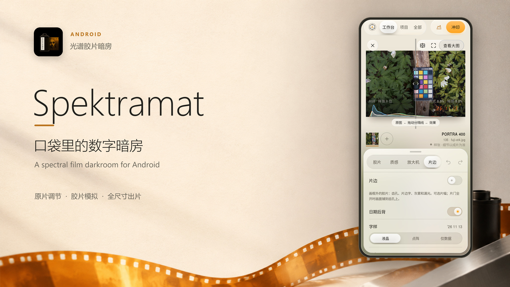
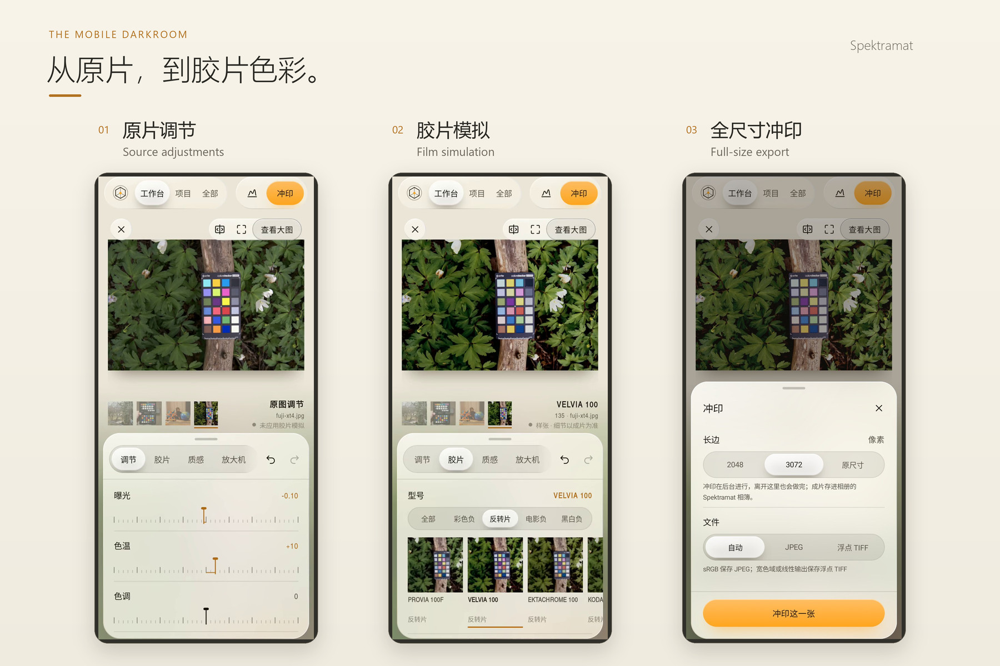
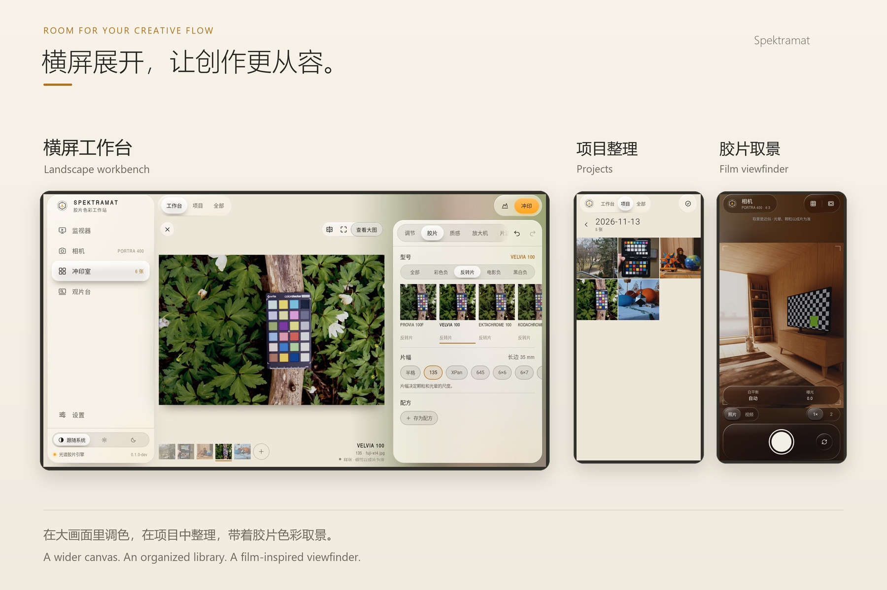
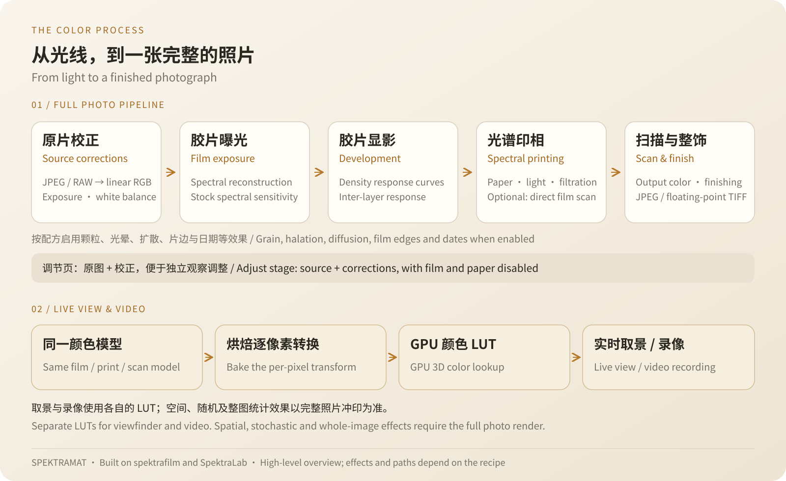

# Spektramat

**把光谱胶片冲印带到 Android。**

[](LICENSE)

[](https://github.com/Knonoa/Spektramat/releases/tag/v0.1.0-preview.1)

中文 · [English](README.en.md) · **[下载 Android 预览版](https://github.com/Knonoa/Spektramat/releases/tag/v0.1.0-preview.1)** · [观看介绍](https://github.com/Knonoa/Spektramat/releases/download/v0.1.0-preview.1/spektramat-intro.mp4)

[](https://github.com/Knonoa/Spektramat/releases/download/v0.1.0-preview.1/spektramat-intro.mp4)

从一张原片出发，调好曝光与颜色，挑选胶片，在放大机下决定相纸与滤色，最后冲印成片。Spektramat 把这一套流程装进手机：**25 款胶片、9 款相纸、可保存的配方，以及完整照片引擎。** 照片处理在设备本地完成。

它基于 [spektrafilm](https://github.com/andreavolpato/spektrafilm) 的光谱胶片模型，结合 [SpektraLab](https://github.com/JamesQiu2005/SpektraLab) 的原生参考实现和胶片、相纸资产。当前为预览版，界面以中文为主。

## 调好原片，再决定胶片



五道工序，把原片变成自己的成片：

| 调节 | 胶片 | 质感 | 放大机 | 片边 |
| --- | --- | --- | --- | --- |
| 曝光、白平衡、曲线、HSL、色彩分级与暗角 | 25 款胶片、片幅与配方 | 颗粒、光晕、层间效应与适用的相纸眩光 | 9 款相纸或直接扫描底片，调整印相曝光和黄／品红滤色 | 齿孔、片边文字、帧号、灰雾、漏光、片门与日期后背 |

- **先看清校正。**「调节」页直接展示原片上的调整，切换到后续工序再查看胶片与印相结果。
- **把喜欢的效果留下。** 保存配方，多选照片后批量套用、批量冲印；撤销、重做、自动保存、直方图和原图对比帮助你反复推敲。
- **把成片带走。** 按所选尺寸导出 sRGB JPEG，或保留输出空间与匹配 ICC 的浮点 TIFF。日期后背也可独立于片边启用。

## 给照片留出空间

竖屏随手调整，横屏把照片和参数并排展开。照片始终留在独立画框里：双指缩放 **1–8 倍**，双击放大或还原，放大后拖动查看细节；「适合画框」复位，「查看大图」展开画面。



**从整理到拍摄，也在这间暗房里。**

- **项目片库**：双列卡片与叠放缩略图，按日期归档导入照片，支持多选、配方和批量冲印。
- **手机相机**：GPU 胶片实时取景、JPEG/RAW 拍摄、拍后冲印与构图线；按设备能力提供镜头和手动控制，以及 1080p / 720p / 480p 视频选项。
- **Sony USB 监视器**：USB 取景、参数读取、遥控快门与原片接收，把相机带入移动工作流。
- **观片台**：在灯箱上拖动、缩放、旋转、吸附和整理照片，调节背光、用放大镜检查细节，再导出排布。

## 从光谱到成片



完整照片引擎以 **81 个波长采样**模拟胶片与相纸过程：原片校正后，计算胶片曝光与显影，再经过光谱印相、扫描和整饰。反转片或直接扫描可以绕过相纸步骤；启用的颗粒、光晕等效果参与照片处理。

**照片使用完整引擎，拍摄取景使用 GPU 颜色 LUT。** 工作台后续工序预览、胶片缩略图和最终冲印均运行完整照片引擎；预览以较小源图控制计算量。照片的胶片—印相—扫描转换不依赖简化的颜色 3D LUT，参考算法自身的光谱重建表仍参与计算。

手机实时取景和视频使用从完整逐像素胶片、印相、扫描转换烘焙的 LUT；取景配合动态测光，配方变化时在后台更新。它们不能表达光晕、颗粒、扩散等空间或随机效果，片边与日期也以照片成片为准。拍摄保存的 JPEG/RAW 原片保持原始内容，入库后由完整引擎处理。

「调节」页是原片校正预览，不叠加胶片、相纸、颗粒、片边或日期。预览与全尺寸成片可能因采样尺度出现差异，随机纹理也不保证与 Python 逐像素相同。固定上游版本、资产哈希和已执行的确定性／随机分布验证，见 [算法验证记录](docs/算法对齐验证-2026-11-12.zh-CN.md)、[GPU 取景说明](docs/相机GPU实时预览-2026-11-12.zh-CN.md) 与 [视频 LUT 说明](docs/视频LUT实现与验证-2026-11-12.zh-CN.md)。

## 开始你的第一张冲印

需要 **Android 8.0+、OpenGL ES 3.0**；当前包含 `arm64-v8a` 与 `x86_64`，不包含 32 位 ARM。

1. 在 [Release 的 Assets](https://github.com/Knonoa/Spektramat/releases/tag/v0.1.0-preview.1) 下载并安装 **`Spektramat-v0.1.0-preview.1.apk`**。
2. 进入「冲印室」，从相册、文件或其他应用导入照片。支持 JPEG、PNG；HEIC 取决于系统解码能力，RAW 取决于解码器支持。
3. 依次调整 **调节 → 胶片 → 质感 → 放大机 → 片边**，点「冲印」选择尺寸和自动、JPEG 或浮点 TIFF 格式。

Android 10 及以上通过 MediaStore 保存到图库 `Pictures/Spektramat`；Android 8/9 保存到应用私有 `files/prints`，可通过分享导出。相机、麦克风和照片权限按功能申请。

<details>
<summary>预览版身份与兼容性</summary>

本次发布为 **debug 签名 APK**：应用 ID `com.spektra.latent.dev`，应用内版本 `0.1.0-dev`，Release 标签 `v0.1.0-preview.1`。可与正式包 `com.spektra.latent` 并存；覆盖更新需要相同应用 ID 与签名。

主要自动化和布局验证在 API 31 模拟器完成，当前 APK 已在 vivo V2454DA 安装并启动。当前版本的硬件 JPEG/RAW 拍摄、视频编码稳定性与 Sony USB 联机仍需进一步真机验收，不承诺固定帧率或所有设备兼容。完整处理需要计算时间和内存；部分上游高级参数、自定义色彩空间与光源尚无界面入口。浮点 TIFF 的 float32 文件样本来自 Android F16 成片，并非全流程 float32 精度。

Sony 监视器在 Android 10 及以上可将额外原片复制到 `Download/Spektramat`，监看录像保存到 `Movies/Spektramat`。Android 8/9 的监看录像保存在应用专属目录，暂不支持将原片另存到公共下载目录。

遇到问题请在 [Issues](https://github.com/Knonoa/Spektramat/issues) 附上设备型号、Android 版本、复现步骤与截图；图像问题可附可公开的样片和配方。

</details>

## 原片与项目，如何保存

导入会**复制**原片到应用私有片库，编辑记录单独保存，不覆盖来源照片。默认按本地日期复用 `yyyy-MM-dd` 项目；指定已有项目时保留该目标。画框上的 **×** 仅移出工作台。

长按项目可选择「从 App 中删除」（持久隐藏，保留内部原片，目前没有恢复界面），或「从硬盘中删除」（二次确认后删除该项目内部原片、缩略图与编辑记录，失败项保留以便重试）。两者均保留导入来源、已导出的成片，以及同一日期目录中其他项目的照片。**卸载会清除私有片库和设置。** 路径与旧项目兼容说明见 [项目与日期目录](docs/项目删除与日期目录-2026-11-13.zh-CN.md)。

## 观看介绍

| 版本 | 海报 | 介绍视频 |
| --- | --- | --- |
| 横版 | [查看 JPG](docs/media/spektramat-cover.jpg) | [观看 / 下载](https://github.com/Knonoa/Spektramat/releases/download/v0.1.0-preview.1/spektramat-intro.mp4) · [仓库文件](docs/media/spektramat-intro.mp4) |
| 竖版 | [查看 JPG](docs/media/spektramat-cover-portrait.jpg) | [观看 / 下载](https://github.com/Knonoa/Spektramat/releases/download/v0.1.0-preview.1/spektramat-intro-portrait.mp4) · [仓库文件](docs/media/spektramat-intro-portrait.mp4) |

## 从源码构建

使用 **JDK 17、Android SDK 35、NDK 27.2.12479018、CMake 3.22.1**，在 Android Studio 打开仓库，或配置 SDK 后运行：

```powershell
git clone https://github.com/Knonoa/Spektramat.git
cd Spektramat
.\gradlew.bat :app:assembleDebug
```

macOS / Linux 使用 `./gradlew :app:assembleDebug`；输出 `app/build/outputs/apk/debug/app-debug.apk`。引擎资产已包含，普通构建无需重新烘焙。Kotlin/Compose 应用、C++20 引擎与测试入口见 [开发说明](docs/开发.md) 和 [参考一致性测试](tools/parity/README.md)。

## 开源许可与致谢

代码使用 **[GNU GPL v3](LICENSE)**；第三方数据与组件保留各自许可。Spektramat 的光谱工作流建立在以下项目与作者的工作之上：

| 来源 | 贡献与许可 |
| --- | --- |
| **Andrea Volpato / [spektrafilm](https://github.com/andreavolpato/spektrafilm)** | 胶片过程模型与测量配置。配置、派生 LUT 和相关编码资产采用 **CC BY-SA 4.0**，见 [署名说明](engine/src/main/assets/licenses/spektrafilm/NOTICE.txt)、[许可全文](engine/src/main/assets/licenses/spektrafilm/CC-BY-SA-4.0.txt) 与 [来源及变更记录](engine/src/main/assets/licenses/spektrafilm/CHANGELOG.txt)。 |
| **[SpektraLab](https://github.com/JamesQiu2005/SpektraLab)** | 原生参考实现和产品胶片／相纸资产，保留 [GPL v3](engine/src/main/assets/licenses/SpektraLab/GPL-3.0.txt)。额外黑白配置署名 **Hanze Qiu**。 |
| **[LibRaw](https://www.libraw.org/)、[libgphoto2](https://github.com/gphoto/libgphoto2)、stb** | RAW 解码（LGPL / CDDL）、Sony PTP 协议参考和图像处理工具。 |
| **TeX Gyre Heros、DejaVu Sans Mono** | 片边字体，分别使用 GUST Font License 与 DejaVu 字体许可。 |

完整声明见 [licenses](engine/src/main/assets/licenses/)、[fonts](engine/src/main/assets/fonts/) 和 [stb 许可](engine/src/main/cpp/third_party/STB_LICENSE)。再分发时请保留版权与数据署名，并按适用许可证提供源码。

本页使用真实 App 界面，画面中的测试照片来自 raw.pixls.us 的 CC0 样片，详见 [媒体来源与视频制作记录](docs/media/intro-production.md)。横竖海报使用 grsai 的 **gpt-image-2.6** 生成装饰背景，再合成真实界面与图标，详见 [海报制作记录](docs/media/cover-generation.md)。
