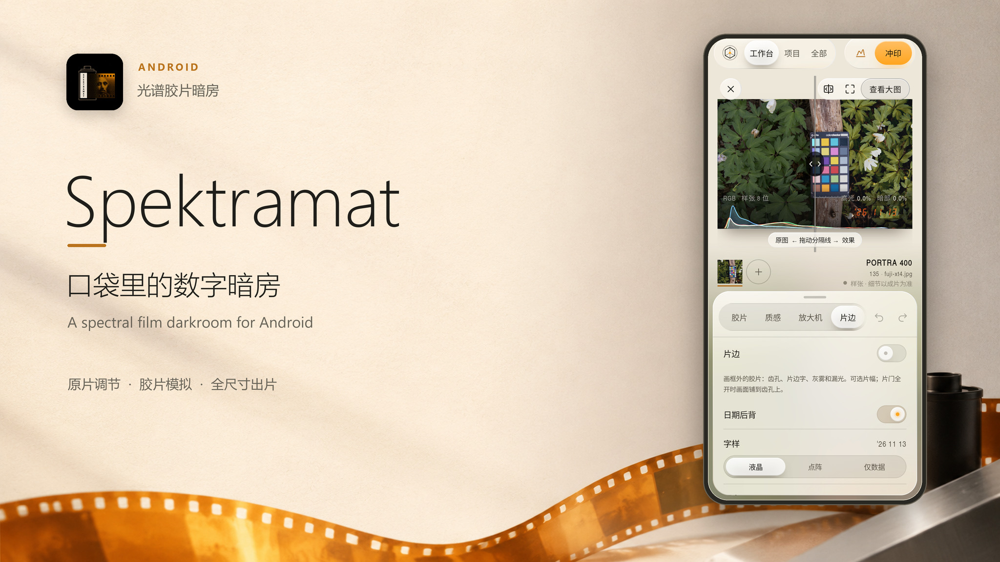

# Spektramat v0.1.0-preview.1

首个 Android 预览版：把原片调节、光谱胶片模拟、放大机和全尺寸出片带到手机。



[中文介绍](https://github.com/Knonoa/Spektramat/blob/v0.1.0-preview.1/README.md) · [English README](https://github.com/Knonoa/Spektramat/blob/v0.1.0-preview.1/README.en.md)

介绍视频 / Introduction: [横版 / Landscape](https://github.com/Knonoa/Spektramat/releases/download/v0.1.0-preview.1/spektramat-intro.mp4) · [竖版 / Portrait](https://github.com/Knonoa/Spektramat/releases/download/v0.1.0-preview.1/spektramat-intro-portrait.mp4)

宣传海报 / Posters: [横版 / Landscape](https://github.com/Knonoa/Spektramat/releases/download/v0.1.0-preview.1/spektramat-cover.jpg) · [竖版 / Portrait](https://github.com/Knonoa/Spektramat/releases/download/v0.1.0-preview.1/spektramat-cover-portrait.jpg)

## 中文

- 五道工序：**调节 → 胶片 → 质感 → 放大机 → 片边**。调节页在原图上校正，其他工序和最终照片冲印使用完整照片引擎。
- 支持照片与 RAW 导入、25 款胶片、9 款相纸、配方、颗粒、光晕、片边、日期，以及 JPEG / 浮点 TIFF 导出。
- 工作台支持受限平移、缩放、横屏布局、长按原图及分隔线对比；左上角 × 仅将照片从工作台移除。
- 项目以两列堆叠封面显示。长按可从 App 移除并保留文件，或二次确认后删除 App 内原片副本。默认导入使用 `yyyy-MM-dd` 项目及目录。
- 手机相机实时取景使用 GPU LUT；录像采用完整逐像素转换烘焙的独立 LUT。依赖邻域、全局统计和随机采样的效果以完整照片冲印为准。
- 包含 Sony USB 监视器及自由排列的观片台；Sony 真机联机与各机型拍照/录像兼容性仍需进一步验证。

**安装**：下载附件 `Spektramat-v0.1.0-preview.1.apk`，在 Android 8.0 / API 26 以上、支持 OpenGL ES 3.0 的设备安装。包含 `arm64-v8a` 和 `x86_64`，不包含 32 位 ABI。

这是当前已测试 APK 的**调试签名预览发布**：包名 `com.spektra.latent.dev`，应用内版本 `0.1.0-dev`，versionCode `1`；Release 标签为 `v0.1.0-preview.1`。保留原签名与 APK 字节，支持覆盖安装同签名开发版。不同签名的包无法直接覆盖；卸载会清除应用私有片库，请先导出需要保留的照片。未来正式签名版本的迁移方式尚未确定。

本轮验证：41 项 JVM 测试、10 项设备测试通过，照片路由检查 `PHOTO_ROUTE_FAILURES 0`；已覆盖安装到 vivo V2454DA。验证范围与具体设备记录见仓库 `docs/`，不代表全部 Android 设备或外接相机均已验证。

## English

The first Android preview brings original-photo adjustments, spectral film simulation, enlarger controls, and full-resolution export to your phone.

- Five stages: **Adjust → Film → Texture → Enlarger → Film edges**. Adjust shows corrections on the original; other stages and final photo exports use the full photo engine.
- Photo and RAW import, 25 film stocks, 9 papers, recipes, grain, halation, film edges, date imprints, and JPEG / floating-point TIFF export.
- Bounded pan and zoom, landscape layouts, press-and-hold original comparison, and a draggable comparison divider. The × button removes a photo from the workbench while keeping it in the library.
- Two-column projects with stacked covers. Long-press to remove a project from the app while retaining files, or confirm again to delete its app-managed original copies. Default imports use a `yyyy-MM-dd` project and directory.
- GPU LUTs power camera live view; recording uses a separate LUT baked from the complete per-pixel conversion. Spatial, image-wide, and stochastic effects require the full photo render.
- Sony USB monitoring and a freely arranged light table are included. Physical Sony tethering and camera/video compatibility across devices still need broader validation.

**Install** the attached `Spektramat-v0.1.0-preview.1.apk` on Android 8.0 / API 26 or newer with OpenGL ES 3.0. The APK contains `arm64-v8a` and `x86_64`; 32-bit ABIs are not included.

This is a **debug-signed preview of the tested APK**, retaining its original bytes and signature. Package: `com.spektra.latent.dev`; app version: `0.1.0-dev`; versionCode: `1`. The release tag is `v0.1.0-preview.1`. It updates development builds with the same signature. A different signature requires migration; uninstalling clears the private library, so export any photos you need before uninstalling. Migration to a future production signing key is not yet defined.

Validation: 41 JVM tests and 10 device tests passed; the photo-route guard reports `PHOTO_ROUTE_FAILURES 0`. The APK was installed on a vivo V2454DA. See `docs/` for scope and device records; these checks do not establish compatibility with every Android device or external camera.

## Assets and checksum

- `Spektramat-v0.1.0-preview.1.apk` — Android preview, 95,112,357 bytes.
- `SHA256SUMS.txt` — checksums for the downloadable assets.
- `spektramat-intro.mp4` — 46-second, 1920 × 1080 product introduction with Chinese and English captions.
- `spektramat-intro-portrait.mp4` — 46-second, 1080 × 1920 introduction, with its own layout and captions.
- `spektramat-intro.srt` — Chinese / English subtitle transcript for both video formats.
- `spektramat-cover.jpg` — 2048 × 1152 landscape poster made with grsai **gpt-image-2.6**, composited with the real app screen and icon.
- `spektramat-cover-portrait.jpg` — 1152 × 2048 portrait poster using the same model and visual identity.

APK SHA-256:

```text
54100cfbd7501ce59e43dc7984cadd45c83758242a7c98ad9489e313fa67430f
```

Source code is available at this tag and in the automatically generated source archives. The project is GPL-3.0; upstream profile/data and third-party notices are retained in the repository and APK.
